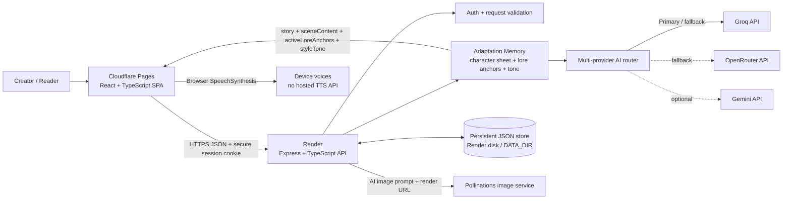

# Canon Studio

**An adaptive AI narrative studio for stories that remember their characters, world rules, and tone.**

[Live app](https://canon-studio.pages.dev) · [API health](https://canon-studio.onrender.com/api/health) · [GitHub repository](https://github.com/Anmolop97/Canon-Studio)

Canon Studio combines a guided story wizard, branching interactive fiction, a continuity-aware writing workspace, and a community library. Its adaptation layer assembles relevant character and lore memory into each generation prompt and returns the active anchors for readers to inspect.

## Architecture



### Request lifecycle

1. React sends creator choices to the Render API over HTTPS.
2. The API validates the request and applies request and AI limits.
3. Adaptation Memory resolves an active character sheet, creator-provided setting and rules, relevant built-in canon when applicable, prior scene text, language, and style tone.
4. The provider router calls a configured LLM and falls back across configured providers when one fails. Deterministic narrative fallbacks remain available when no provider is configured.
5. The API returns the story or scene with adaptation metadata. The UI displays the tone and lore anchors used for that generation.
6. Narration uses browser SpeechSynthesis. Illustration uses an AI-created image prompt and Pollinations image rendering.

## Adaptation Integration

The adaptation layer lives in `backend/src/services/adaptationMemory.ts` and is used by the guided wizard and branching story generation.

- **Character memory:** wizard protagonist choices become an active character sheet. Branching stories use the creator's premise as the protagonist identity source. Known Canon Studio characters can resolve to their archetype, mannerisms, signature phrases, and forbidden patterns.
- **World and canon memory:** creator-supplied setting/lore and rules become prompt constraints. The resolver selects relevant rules from the built-in `Neon Eclipse` story bible when the premise matches them. Otherwise it includes the creator's world context and a continuity rule that preserves established facts and consequences.
- **Style conditioning:** genre, realism/atmosphere, and optional `styleTone` are assembled into an explicit system-prompt instruction.
- **Multilingual prompting:** English, Hindi in Devanagari, and Hinglish in Roman script are explicitly requested in the story-generation prompt.
- **Branch memory:** later scenes receive the story so far and the selected action alongside adaptation inputs, preserving continuity across choices.
- **Inspectable results:** generation responses include `sceneContent`, `activeLoreAnchors` (each anchor has `id`, `label`, and `detail`), and `styleTone`. The existing `content` field remains for compatibility.

Example metadata:

```json
{
  "sceneContent": "The generated scene text...",
  "activeLoreAnchors": [
    { "id": "active-protagonist", "label": "Active character sheet", "detail": "..." },
    { "id": "continuity-1", "label": "Active world setting", "detail": "..." }
  ],
  "styleTone": "Sci-fi · grounded speculative · cinematic, character-led prose"
}
```

## Technology Stack

| Layer | Technologies |
| --- | --- |
| Web client | React 19, TypeScript, Vite, Tailwind CSS, Motion |
| API | Node.js, Express 4, TypeScript |
| Identity | PBKDF2-SHA512 password hashes, signed session token in HttpOnly cookie |
| Data | JSON file store; use persistent disk and `DATA_DIR` in production |
| Text generation | Groq, OpenRouter, Gemini (configured providers form a failover chain) |
| Image generation | AI prompt direction plus Pollinations image rendering |
| Narration | Browser SpeechSynthesis |
| Hosting | Cloudflare Pages frontend, Render backend |

## Environment Variables

Use a hosting provider's secret manager or a local `backend/.env`. **Never commit real provider credentials.**

| Variable | Required | Description |
| --- | --- | --- |
| `NODE_ENV` | Deployment | `production`, `development`, or `test`; hosted deployments require `production`. |
| `AUTH_SECRET` | Production | Random secret with at least 32 bytes of entropy. |
| `GROQ_API_KEY` | Optional | Groq provider credential. At least one LLM provider key is needed for live AI. |
| `GROQ_MODEL` | Optional | Groq model override. |
| `OPENROUTER_API_KEY` | Optional | OpenRouter fallback credential. |
| `OPENROUTER_MODEL` | Optional | OpenRouter model override. |
| `GEMINI_API_KEY` | Optional | Gemini fallback / visual prompt credential. |
| `GEMINI_MODEL` | Optional | Gemini model override. |
| `PORT` | Optional | Backend port; defaults to `5000`. |
| `HOST` | Optional | Bind address; defaults to `0.0.0.0`. |
| `FRONTEND_URL` | Recommended | Comma-separated allowed frontend origins. |
| `ALLOWED_ORIGINS` | Optional | Additional comma-separated allowed origins. |
| `TRUST_PROXY_HOPS` | Deployment-specific | Trusted reverse-proxy hop count for client IP handling. |
| `RATE_LIMIT_AI_MAX` | Optional | AI request limit per client/window; defaults to `10`. |
| `RATE_LIMIT_AI_WINDOW_MS` | Optional | AI rate-limit window in milliseconds; defaults to `60000`. |
| `AI_DAILY_QUOTA_MAX` | Optional | Per-process daily AI request ceiling; defaults to `2000`. |
| `DATA_DIR` | Production recommended | Persistent directory for `db.json` on the backend host. |
| `COOKIE_SAMESITE` | Optional | Cookie `SameSite` override; production defaults to `None` for cross-origin Pages/API. |
| `VITE_API_BASE` | Optional | Frontend API base URL; production defaults to the hosted Render API. |

## Local Development

Prerequisites: Node.js 20.18+ or 22.x and npm 10+.

```bash
git clone https://github.com/Anmolop97/Canon-Studio.git
cd Canon-Studio
cd backend && npm install
cd ../frontend && npm install
```

Create `backend/.env`:

```env
PORT=5000
HOST=127.0.0.1
NODE_ENV=development
AUTH_SECRET=local-development-secret-with-at-least-32-characters
GROQ_API_KEY=your_groq_api_key_here
# Optional:
# OPENROUTER_API_KEY=your_openrouter_api_key_here
# GEMINI_API_KEY=your_gemini_api_key_here
```

Run each app in a separate terminal:

```bash
cd backend && npm run dev
```

```bash
cd frontend && npm run dev
```

Build both applications:

```bash
cd backend && npm run build
cd ../frontend && npm run build
```

## API Endpoints

All endpoints are under `/api`. AI generation endpoints are public and rate-limited; draft endpoints require the signed-in user's session cookie.

| Endpoint | Method | Purpose |
| --- | --- | --- |
| `/health` | GET | API and configured-provider status |
| `/auth/register`, `/auth/login` | POST | Create an account or start a session |
| `/auth/me` | GET | Read current session user |
| `/auth/logout` | POST | Clear session cookie |
| `/wizard/next-question` | POST | Generate a contextual wizard question |
| `/wizard/generate-story` | POST | Generate a story with adaptation metadata |
| `/choose-path/generate-scene` | POST | Start or continue a branching story with lore metadata |
| `/branching/start`, `/branching/next` | POST | Backward-compatible branching routes |
| `/branching/export-journey` | POST | Export an interactive journey |
| `/branching/illustrate-scene` | POST | Generate scene artwork |
| `/drafts` | GET, POST | List or create the signed-in user's drafts |
| `/drafts/:id` | GET, PUT, DELETE | Read or change an owned draft |
| `/drafts/:id/ai-draft` | POST | Generate an episode draft |
| `/drafts/:id/check-canon` | POST | Audit draft continuity |
| `/drafts/:id/publish`, `/drafts/:id/unpublish` | POST | Publish or unpublish a draft |
| `/books`, `/books/best`, `/books/:id` | GET | Browse, rank, and read published books |
| `/books/:id/like`, `/books/:id/rate` | POST | Like or rate a published book |
| `/audit-lore`, `/analyze-voice`, `/story/generate-beat` | POST | Lore, voice, and scene-generation compatibility routes |
| `/story-tree` | GET | Inspect the built-in story tree |

For `/choose-path/generate-scene`, send setup fields on the first request. For a continuation, send `storySoFar`, `chosenOptionText`, `decisionIndex`, and the same premise/style fields. `maxDecisions` must be `3`, `5`, or `8`.

## Project Links

- [Live application](https://canon-studio.pages.dev)
- [API health](https://canon-studio.onrender.com/api/health)
- [GitHub repository](https://github.com/Anmolop97/Canon-Studio)
