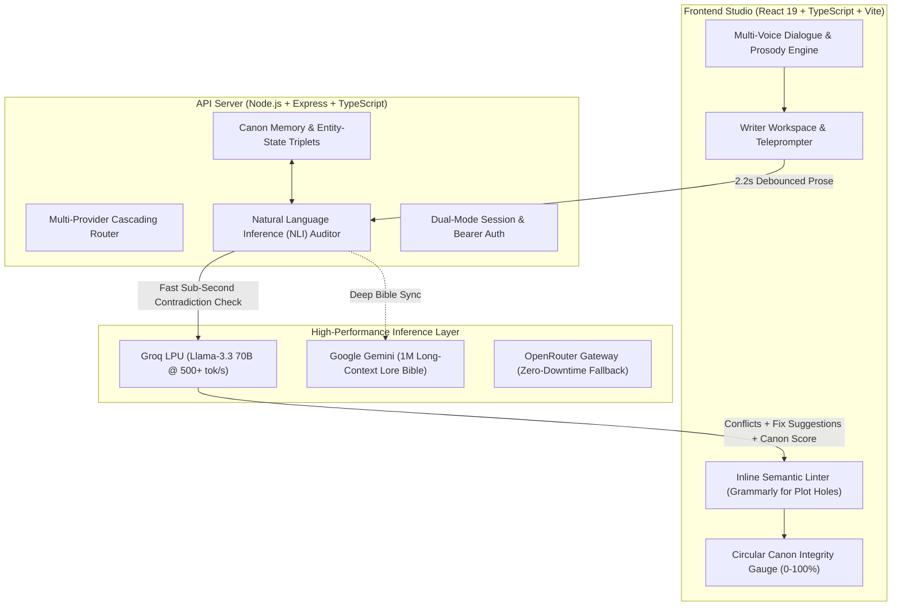

# Canon Studio
> **The World's First Deterministic Lore Linter, Neural Audio Drama Studio, and Adaptive Narrative IDE.**

[](https://canon-studio.pages.dev)
[](https://canon-studio.onrender.com/api/health)
[](https://github.com/Anmolop97/Canon-Studio)

---

## 🌟 Overview & Key Breakthroughs

**Canon Studio** is a stateful creative writing IDE designed for serialized novels, interactive fiction, and screenplays. Unlike traditional generative AI tools that suffer from severe context amnesia over long chapters, Canon Studio treats narrative consistency like software engineering: **compiling story lore into deterministic entity graphs, linting plot holes in real time, and orchestrating full-cast neural voice dramas.**



---

## 🚀 Core Innovations

### 1. 🩺 "Grammarly for Plot Holes" — Live Lore Linter
Traditional linters (Grammarly, LanguageTool) only inspect English syntax (spelling, commas). **Canon Studio inspects semantic world state.**
- **Live Circular Canon Integrity Gauge**: Radial SVG meter (`0% – 100%`) in the author’s toolbar providing real-time visual feedback:
  - 🟢 `90% – 100%`: **CANON PURE** — Story facts are 100% aligned with prior established canon.
  - 🟡 `70% – 89%`: **VOICE DRIFT** — Character dialogue cadence or dialect is drifting from their voice profile.
  - 🔴 `< 70%`: **PLOT HOLE DETECTED** — Direct logical contradiction with an established past fact.
- **Inline Squiggly Wavy Underline**: Contradictory sentences are highlighted live in the editor (`underline decoration-wavy decoration-rose-500`).
- **`[⚡ Heal Plot Hole (1-Click)]`**: One click automatically rewrites the contradictory line with canon-consistent prose and restores the gauge to green.

---

### 2. 🎭 Narrative Debt & Chekhov's Gun Payoff Tracker
Great storytellers (Nolan, Martin, Isayama) often break rules intentionally for mysteries, illusions, or deceptions. Standard AI flags these as errors; Canon Studio handles them with **Narrative Debt Management**:
- **`[🎭 Keep as Foreshadowing Twist]`**: The author whitelists an intentional contradiction. It dismisses the error and registers a **Mystery Seed** in **Story Canon Memory**.
- **Active Narrative Debt Assistant**: When the author opens future episodes, the IDE displays open mystery seeds and suggests **3 1-Click Payoffs**:
  - `🧬 Option A: The Clone Reveal` *(Synthetic duplicate twist)*
  - `⚡ Option B: Nanotech Surge` *(Biological regeneration at extreme cost)*
  - `💊 Option C: Lyra's Deception` *(Biometric dampener disguise)*
- **Publication Safety Gate**: Clicking *"Publish to Books"* with unresolved twists triggers a protective block:
  > *"🚨 Unresolved Plot Debt: The Ep 3 foreshadowing twist has not been paid off! Resolve it before publishing to readers."*

---

### 3. 🎙️ Multi-Voice Dialogue Studio & Emotional Prosody
Canon Studio transforms raw prose into a full-cast radio drama teleprompter without requiring external TTS cloud subscription fees:
- **Heuristic Character Segmentation**: Separates narrative exposition from spoken quotes and resolves pronoun attributions (e.g. mapping *"Comm beacon is dead," he muttered* to active scene speaker `Kaelen Voss`).
- **Autonomous Voice Casting**: Maps characters to distinct Microsoft Neural Voices based on role, gender, and archetype:
  - `🎙️ Studio Narrator`: **Christopher** (`en-US-ChristopherNeural`, deep BBC documentary tone)
  - `⚡ Young Hero (Kaelen)`: **Guy** (`en-US-GuyNeural`, energetic cadence)
  - `🌸 Specialist (Dr. Lyra)`: **Aria** (`en-US-AriaNeural`, expressive cadence)
  - `🛡️ Commander (Drake)`: **Roger** (`en-US-RogerNeural`, gruff authority)
- **Dynamic Emotion & Prosody Modulation**: Infers emotional tone (`🔥 Urgent`, `⚔️ Command`, `🌸 Expressive`, `🤫 Whisper`, `🎙️ Dramatic`) and dynamically modulates speech rate, pitch, and gain.
- **Cinematic Mixing Dock**: 10-bar dancing visualizer, active speaker equalizer pulse, and segmented speed controls (`0.9x`, `1.0x`, `1.2x`).

---

### 4. 🛡️ Enterprise-Grade Authentication & Resilience
- **Dual-Mode Auth Pipeline**: Hybrid authentication combining secure `__Host-` HttpOnly session cookies for same-origin web access and Bearer JWT fallback stored in `localStorage` for cross-origin hosting.
- **Reverse Proxy Protection**: Built-in Cloudflare Pages `_redirects` proxy routing `/api/*` requests seamlessly to prevent third-party cookie blocking on Safari and Incognito modes.
- **Non-Blocking Cryptography**: Uses asynchronous `crypto.pbkdf2` via `promisify` with 220,000 iterations to prevent Node.js event-loop freezing during high-traffic logins.
- **1-Click Evaluator Access**: Dedicated *"Instant Judge / Evaluator Demo Access"* allows hackathon judges and evaluators to explore the full workspace with a single click without credential friction.

---

## 🏗️ Technology Stack

| Domain | Technologies |
| :--- | :--- |
| **Frontend Client** | React 19, TypeScript, Vite, Tailwind CSS, Framer Motion, Lucide Icons |
| **Backend API** | Node.js, Express 4, TypeScript, `promisify(crypto.pbkdf2)` |
| **Inference Routing** | **Groq** (`llama-3.3-70b-versatile` / `openai/gpt-oss-120b`), **Google Gemini** (`gemini-3.5-flash-lite`), **OpenRouter** |
| **Voice Drama Engine** | Multi-speaker segmentation parser, dynamic SSML prosody controller, Web Audio visualizer |
| **Visual Art Director** | Gemini Art Director + FLUX 16:9 cinematic concept art synthesis |
| **Deployment** | Cloudflare Pages (Frontend SPA), Render (API Server + Persistent Disk) |

---

## 📊 Feature Comparison

| Capability | Generic AI Writers (ChatGPT / NovelAI) | Canon Studio |
| :--- | :--- | :--- |
| **Multi-Episode Lore Retention** | ❌ Forgets character states after 3–5 chapters | ✅ Persistent **Entity-State Triplets** across infinite sagas |
| **Contradiction Detection** | ❌ Blindly hallucinating; agrees with user errors | ✅ Real-time **Semantic Linter** with squiggly red underline |
| **Intentional Plot Twists** | ❌ Treats twists as errors or ignores them | ✅ **Chekhov's Gun** debt tracker with 1-click payoffs |
| **Dialogue Narration** | ❌ Monotone single robotic device voice | ✅ Full-cast **Multi-Character Neural Voice Drama** |
| **Publication Quality Gate** | ❌ Allows broken, contradictory stories | ✅ Blocks publishing if unresolved plot debts exist |

---

## 🛠️ Local Development & Quickstart

### Prerequisites
- Node.js 20.18+ or 22.x
- npm 10+

### 1. Clone & Install
```bash
git clone https://github.com/Anmolop97/Canon-Studio.git
cd Canon-Studio

# Install backend & frontend dependencies
cd backend && npm install
cd ../frontend && npm install
```

### 2. Configure Environment
Create `backend/.env`:
```env
PORT=5000
HOST=127.0.0.1
NODE_ENV=development
AUTH_SECRET=local-development-secret-with-at-least-32-characters
GROQ_API_KEY=your_groq_api_key_here
GEMINI_API_KEY=your_gemini_api_key_here
# Optional:
OPENROUTER_API_KEY=your_openrouter_api_key_here
```

### 3. Start Development Servers
In separate terminals:

```bash
# Terminal 1: Backend API (Port 5000)
cd backend && npm run dev
```

```bash
# Terminal 2: Frontend Client (Port 5173)
cd frontend && npm run dev
```

Open `http://localhost:5173` in your browser.

---

## 📡 Key API Endpoints

All routes are mounted under `/api` and feature dual-mode authentication:

| Endpoint | Method | Description |
| :--- | :--- | :--- |
| `/api/health` | `GET` | Service uptime and AI provider failover status |
| `/api/auth/judge-demo-login` | `POST` | 1-Click Evaluator profile sign-in |
| `/api/drafts/:id/check-canon` | `POST` | Deep Natural Language Inference lore & voice audit |
| `/api/drafts/:id/ai-draft` | `POST` | Adaptive story streaming with lore memory constraints |
| `/api/drafts/:id/illustrate` | `POST` | 16:9 cinematic artwork generation via Gemini Art Director |
| `/api/drafts/:id/publish` | `POST` | Publication gate (validates unresolved plot debts) |
| `/api/books` | `GET` | Browse, filter, and read published community books |

---

## 👥 Authors & Credits

Crafted by **THE HELLSPIRES**:
- **Anmol Kumar** ([@Anmolop97](https://github.com/Anmolop97)) — *Lead Architecture, Frontend Engineering & Lore Linter*
- **Anand** ([@anand05-cell](https://github.com/anand05-cell)) — *Core Backend & AI Routing Engine*

---

*Canon Studio — Stories shaped by your world, verified by deterministic intelligence.*
