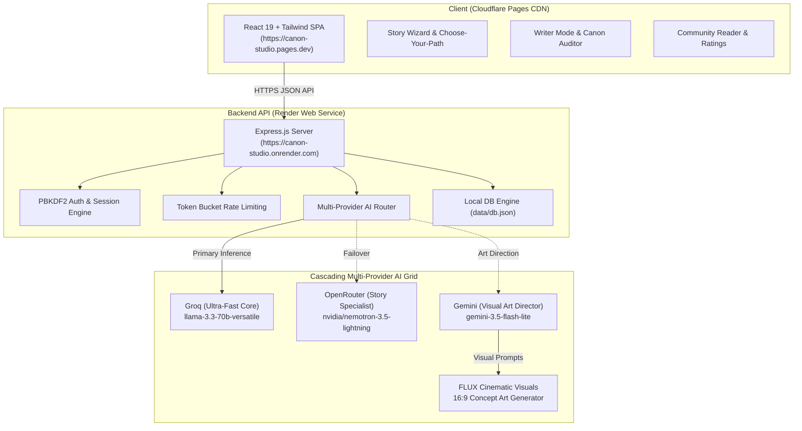

# Canon Studio 🖋️✨

<div align="center">

[](https://canon-studio.pages.dev)
[](https://canon-studio.onrender.com/api/health)
[](https://www.typescriptlang.org/)
[](https://react.dev/)
[](https://groq.com/)
[](https://tailwindcss.com/)

**An AI-Powered Narrative Continuity Studio & Serialized Fiction Platform**

*Where non-writers co-create rich stories, writers publish serialized sagas with automated lore continuity auditing, and readers discover curated community literature.*

[Explore Live Demo](https://canon-studio.pages.dev) • [API Health Monitor](https://canon-studio.onrender.com/api/health) • [Report Bug](https://github.com/Anmolop97/Canon-Studio/issues)

</div>

---

## 🏛️ System Architecture



---

## ✨ Core Pillars & Features

### 1. 🧙 Tab 1 — Write a Story (Zero Friction)
Guided 7-step wizard designed for anyone to write cinematic fiction in minutes:
- **Seed Input**: Free-text keywords → Genre selector → Atmosphere tone → Language (*English / Hinglish / Hindi*).
- **Dynamic Contextual Prompts**: AI generates 6 customized branching questions based on previous answers.
- **Narrative Synthesizer**: Generates balanced story drafts at 400, 800, or 1,400 words with simulated typing.
- **Actions**: Instant Copy, Markdown/TXT Download, **Play as Choose-Your-Path**, or **Transfer to Writer Mode**.

### 2. 🌲 Tab 2 — Choose Your Path (Interactive Branching Narrative)
- **Branching Engine**: Choose narrative complexity (3, 5, or 8 decision depth).
- **Choice Archetypes**: Every scene offers 3 psychological actions (*Bold*, *Careful*, *Unexpected*) + free-form custom action.
- **Interactive Narrative Tree**: Real-time visual graph showing visited choices, active branch path, and story completion milestones.

### 3. 🛡️ Tab 3 — Writer Mode & Canon Continuity Engine
Professional serialization workspace with automated lore defense:
- **Living Canon Extraction**: Automatically scans episodes to extract world facts, character conditions, and inventory.
- **Lore Contradiction Checker**: Flags lore drift, physical impossibilities (e.g., damaged limbs, broken comms during storms), and timeline paradoxes with **1-Click Auto-Fix**.
- **Dialogue Voice Fingerprinting**: Audits dialogue authenticity against character archetypes, cynical/formal tone metrics, and forbidden linguistic mannerisms.
- **Visual Director**: Generates 16:9 cinematic scene concept illustrations using AI art direction paired with FLUX renders.

### 4. 📚 Tab 4 — Community Books & Bayesian Reader
- **Bayesian Weighted Rating Algorithm**:
  $$\text{Score} = \text{Weighted Rating} + 0.5 \times \log_{10}(1 + \text{Likes})$$
  $$\text{Weighted Rating} = \frac{n \times \text{Avg} + 3 \times \text{GlobalMean}}{n + 3}$$
- **Full Reading Suite**: Responsive episode pagination, persistent ratings, community likes, and search filters.
- **Audio Synthesis**: Integrated browser speech synthesis narrator with sentence boundary chunking.

---

## 🎨 Design System & Accessibility

| Token | Dark Theme (Default) | Parchment / Light Theme |
|:---|:---|:---|
| **Background** | `#0F1220` (Midnight Slate) | `#FAF6EC` (Warm Paper) |
| **Card / Surface** | `#1B1F36` (Deep Navy) | `#FFFFFF` (Pure Card) |
| **Raised Element** | `#232845` | `#F0EAD8` |
| **Primary Text** | `#F4EEDC` (Warm Bone) | `#1B1F36` (Slate Ink) |
| **Accent Tone** | `#F2B84B` (Amber Gold) | `#D89112` (Honey Gold) |

- **Typography**: `Fraunces` for literary headings & editorial prose; `Inter` for crisp UI controls.
- **Fluid Motion**: Spring-driven page entrance, toast popovers, and smooth tab switches powered by `motion/react`.
- **WCAG AA**: Compliant color contrast ratios, visible keyboard focus rings, and $\ge 44\text{px}$ touch targets.

---

## 🚀 Quickstart & Local Setup

### Prerequisites
- Node.js `20.18+` or `22.x`
- npm `10+`

### 1. Clone & Install
```bash
git clone https://github.com/Anmolop97/Canon-Studio.git
cd Canon-Studio

# Install Backend dependencies
cd backend && npm install

# Install Frontend dependencies
cd ../frontend && npm install
```

### 2. Configure Environment
Create `backend/.env`:
```env
PORT=5000
NODE_ENV=development
AUTH_SECRET=development_secret_must_be_over_32_characters_long_for_security

# AI Inference (Add at least one)
GROQ_API_KEY=your_groq_api_key_here
GEMINI_API_KEY=your_gemini_api_key_here
```

### 3. Run Development Servers
```bash
# Terminal 1: Backend
cd backend && npm run dev
# Running on http://localhost:5000

# Terminal 2: Frontend
cd frontend && npm run dev
# Running on http://localhost:5173
```

---

## 🔑 Showcase 1-Click Accounts

| Display Name | Email | Password | Role |
|:---|:---|:---|:---|
| **Anmol** | `anmol@canonstory.studio` | `kakashi_op_97` | Lead Creator |
| **Anya Sharma** | `anya@canonstory.studio` | `anya123` | Sci-fi Author |
| **Devraj Sen** | `dev@canonstory.studio` | `dev123` | Fantasy Author |
| **Guest Writer** | `guest@canonstory.studio` | `guest123` | Community Member |

---

## 📡 Production API Reference

| Endpoint | Method | Auth | Description |
|:---|:---:|:---:|:---|
| `/api/health` | `GET` | Public | Live system, AI provider status & uptime |
| `/api/auth/login` | `POST` | Public | PBKDF2 session auth with HttpOnly cookie |
| `/api/auth/register` | `POST` | Public | Register new narrative architect |
| `/api/auth/me` | `GET` | Session | Get current authenticated user |
| `/api/wizard/next-question` | `POST` | Public | Generate contextual wizard questions |
| `/api/wizard/generate-story` | `POST` | Public | Generate complete multi-paragraph story |
| `/api/branching/start` | `POST` | Public | Initialize branching story tree |
| `/api/branching/next` | `POST` | Public | Process choice & generate subsequent beat |
| `/api/drafts` | `GET/POST` | Session | Retrieve or create writer drafts |
| `/api/drafts/:id/check-canon` | `POST` | Session | Deep continuity & canon contradiction audit |
| `/api/drafts/:id/publish` | `POST` | Session | Publish serial episode to public Books catalog |
| `/api/books` | `GET` | Public | Browse published books with search & filters |
| `/api/books/best` | `GET` | Public | Retrieve Top 20 Bayesian weighted stories |

---

## 📜 License & Acknowledgments

Distributed under the MIT License. Built with ❤️ for narrative architects, interactive fiction lovers, and worldbuilders worldwide.
